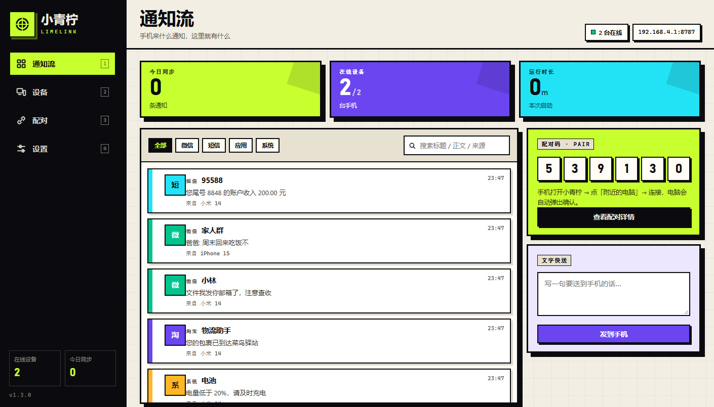
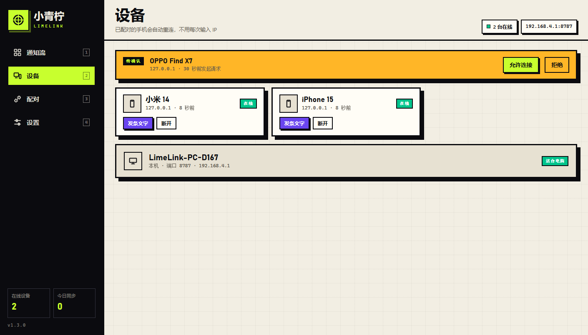
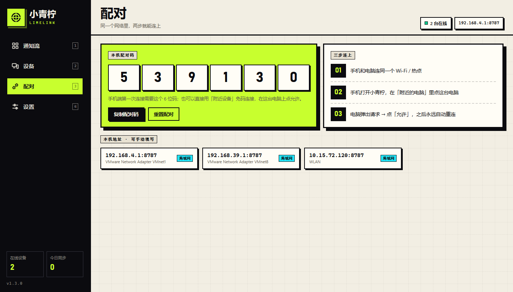

<p align="center">
  
</p>

<h1 align="center">LimeLink（小青柠）v1.3.0</h1>

<p align="center">
  把 Android 通知镜像到 Windows 桌面，局域网直连、原生 Toast 弹出。<br/>
  Go + Kotlin 双端，无需账号、无需云服务器。
</p>

<p align="center">
  <a href="https://github.com/ai123lp456/LimeLink/releases">下载</a> ·
  <a href="#快速开始">快速开始</a> ·
  <a href="#从源码构建">构建</a> ·
  <a href="SECURITY.md">安全模型</a> ·
  <a href="CHANGELOG.md">更新记录</a>
</p>

---

## 这是什么

LimeLink 是一个**局域网优先**的通知同步工具：

- Android 端用 `NotificationListenerService` 读取通知，通过 HTTP 推送到电脑；
- Windows 端用原生 Toast 弹出，同一来源的新通知会**覆盖**旧通知，不排队刷屏；
- 1.3.0 起电脑端有了**图形界面**（通知流 / 设备 / 配对 / 设置），界面风格为高饱和块面（Vibrant & Block-based）；
- 连接方式参考 LocalSend：手机打开 App 就能看到「附近的电脑」，点一下 → 电脑点「允许」→ 完成，不用手输 IP 和配对码。

不联网、不上传云端、不需要注册。手机和电脑连同一个 Wi-Fi / 热点即可。

| 界面 | 预览 |
| --- | --- |
| 通知流 |  |
| 设备 |  |
| 配对 |  |

## 功能

**电脑端（Windows）**
- 系统托盘常驻 + 图形界面（内嵌页面，Edge/Chrome 应用模式开窗，单 exe 无额外依赖）
- 通知流：按来源配色的卡片、分类筛选（微信 / 短信 / 应用 / 系统）、关键词搜索
- 设备页：在线状态、最近心跳、一键发文字到手机、解绑
- 配对页：6 位配对码分块展示、三步连接引导、本机所有网卡地址可复制
- 设置页：设备改名、清空记录、打开数据目录、防火墙命令、诊断信息复制
- 最近 200 条通知记录本地持久化（`%APPDATA%\LimeLink\state.json`）

**手机端（Android）**
- 通知实时推送；四个分类开关（微信 / 短信 / 应用 / 系统）
- 「附近的电脑」自动发现，免码连接（电脑端允许即可）
- 常驻状态通知：未授权 / 已暂停 / 等待连接 / 已连接，可直接暂停与恢复
- 接收电脑端发来的文字，弹出「来自电脑」通知
- 设备名可修改

## 环境要求

- Windows 10 / 11（电脑端）
- Android 7.0+（`minSdk 24`）
- 手机与电脑处于同一局域网，或手机连接电脑的移动热点

## 下载安装

到 [Releases](https://github.com/ai123lp456/LimeLink/releases) 下载：

- `LimeLink-PC-1.3.0.exe` — 免安装，双击运行
- `LimeLink-Android-1.3.0.apk` — 正式签名包，可直接覆盖升级

> 国内镜像仓库：<https://gitee.com/ai123lp456/lime-link>（源码同步，Release 附件建议优先用 GitHub）

## 快速开始

1. **电脑**：运行 `LimeLink-PC-1.3.0.exe`。托盘出现青柠图标，同时弹出界面窗口。
2. **手机**：安装 APK，打开后会自动扫描局域网，「附近的电脑」里出现这台电脑。
3. 点「连接这台电脑」→ 电脑界面弹出「允许连接」→ 点「允许」。手机显示「已连接电脑」。
   - 电脑端没开界面时，用手机下方「配对码连接」填电脑显示的 6 位码。
   - 扫不到电脑时，展开「手动地址」填 IP + 端口（默认 8787）。
4. 首次连接会引导你去系统设置开启「小青柠」的**通知读取权限**（Android 13+ 还会请求通知权限，用于状态条）。
5. 手机来通知，电脑弹 Toast。之后电脑重启、手机重连都会自动恢复，不用重新配对。

### 防火墙

手机能看到电脑但连不上，通常是 Windows 拦了端口：

- 需要放行 **TCP 8787**（通知 / 配对 / 心跳）与 **UDP 8788**（局域网发现）；
- 以管理员身份运行仓库里的 `fix-firewall.ps1`，或手动执行：

```powershell
netsh advfirewall firewall add rule name="LimeLink TCP 8787" dir=in action=allow protocol=TCP localport=8787
netsh advfirewall firewall add rule name="LimeLink UDP 8788" dir=in action=allow protocol=UDP localport=8788
```

脚本按**端口**放行（不绑定程序路径），所以以后换目录、升级都不用重跑；代价是这两个端口对所有程序开放，请在可信局域网使用。

## 连接是怎么做的

```
手机                                     电脑
 │  UDP 8788 broadcast/multicast probe     │
 │ ──────────────────────────────────────► │
 │ ◄──── announce {name, port, ver} ───────│  「附近的电脑」出现
 │                                         │
 │  POST /pair/request  {device_id, name}  │
 │ ──────────────────────────────────────► │  界面弹出「允许连接」
 │ ◄──── {status:"pending", req_id} ───────│
 │  GET /pair/status?id=... （每 1.2s）     │
 │ ◄──── {status:"approved", token} ───────│  点「允许」
 │  GET /heartbeat  (X-LimeLink-Token)     │
 │ ──────────────────────────────────────► │  心跳成功才算真正 CONNECTED
```

- 已配对过的 `device_id` 再次请求会直接放行并回同一个 token —— 这是「电脑重启后手机自动连回」的实现方式。
- 电脑端界面与 `/api/*` 只允许 `127.0.0.1` 访问；手机端用 32 位随机 token 鉴权，每台设备独立。
- 发现报文同时兼容旧版（v1.2.x）的裸字符串探测，老手机仍可用。

## 从源码构建

### 电脑端（Windows + Go 1.21+）

```powershell
cd pc
go test ./...
go build -ldflags "-s -w -H windowsgui" -o bin/limehost.exe ./cmd/limehost
```

产物是单个 exe。图标与版本信息由 `pc/cmd/limehost/rsrc_windows_*.syso` 提供，已随仓库提交，
`go build` 会自动嵌入；改了版本号需要重新生成：

```powershell
cd pc/cmd/limehost
go run github.com/tc-hib/go-winres@v0.3.3 simply --icon assets/lime.ico `
  --product-name "小青柠 LimeLink" --product-version "1.3.0" --file-version "1.3.0" `
  --file-description "LimeLink 电脑端接收器"
```

界面在 `pc/internal/webui/assets/`（HTML/CSS/JS，`go:embed` 打包）。

### Android 端（JDK 17 + Android SDK 34）

仓库带 Gradle Wrapper，首次运行会下载 Gradle 发行包：

```powershell
cd android
./gradlew assembleDebug      # 调试包
./gradlew assembleRelease    # 正式包（需要本地签名配置）
```

没有配置 `ANDROID_HOME` 时，在 `android/local.properties` 写一行 `sdk.dir=<你的 SDK 路径>`（该文件不入库）。

### 发布签名

仓库**不包含**任何 keystore 或密码。要出正式签名包，请自备 keystore 并在 `android/keystore.properties` 填写：

```properties
storeFile=your-release.jks
storePassword=******
keyAlias=******
keyPassword=******
```

`*.jks`、`keystore.properties`、`local.properties` 均在 `.gitignore` 中。已安装用户只能被同一 keystore 签名的包覆盖升级，请自行妥善备份。

## 目录结构

```
LimeLink/
├── pc/                         电脑端（Go）
│   ├── cmd/limehost/           入口、托盘、窗口、Win32 资源
│   └── internal/
│       ├── server/             HTTP 服务：配对 / 心跳 / 通知 / 设备 / 记录 + 界面 API
│       ├── discovery/          UDP 发现（announce / probe / 组播）
│       ├── webui/              内嵌界面（HTML/CSS/JS）
│       ├── notifier/           Windows Toast + 降级
│       ├── toast/              内嵌 go-toast（MIT，新增 Tag/Group）
│       ├── config/             配置
│       └── netinfo/            本机 IP
├── android/                    手机端（Kotlin）
│   └── app/src/main/java/com/limelink/app/
├── assets/                     图标、界面截图、图标生成脚本
├── licenses/                   第三方许可证全文
├── fix-firewall.ps1            防火墙放行脚本
├── CHANGELOG.md                更新记录
├── SECURITY.md                 安全模型与已知边界
└── THIRD_PARTY_NOTICES.md      第三方组件声明
```

## 已知限制

- **仅用于可信局域网**：HTTP 明文传输，不抗同网段窃听，不要映射到公网。
- **界面窗口基于 Chromium 浏览器**：优先 Edge，其次 Chrome；都没有时退回系统默认浏览器（会带地址栏）。这是「单 exe、无 WebView2/CGO」的取舍。
- **首次启动可能慢**：Windows 首次为新 exe 放行端口可能要十几秒到几十秒，界面会显示「正在启动」并自动重试。
- **组播/广播被拦**：部分路由器会拦广播或组播，实现采用三路齐发（全网广播 + 子网广播 + 组播），极端环境仍需手动填 IP。
- **微信内容完整度**：取决于手机是否开「通知显示消息详情」，本工具如实同步、不做猜测。
- **后台保活**：多数国产系统需手动允许后台运行 + 电池白名单，否则监听服务会被杀。
- **Android 15 的 dataSync 前台服务有时长限制**：超时后可能被暂停，重开 App 恢复。
- **安装包未做商业代码签名**：Windows 可能提示 SmartScreen，请核对 Release 中的 SHA256。

## 常见问题

**手机找不到电脑？**
确认电脑端已启动（托盘有小青柠图标）、两端在同一网络、已放行 UDP 8788；仍不行就用「手动地址」填 IP。

**手机显示已连接但电脑不弹窗？**
多为防火墙拦了 TCP 8787，或在电脑端界面「设置 → 查看放行命令」里跑一次放行；也可在电脑本机访问 `http://127.0.0.1:8787/api/state` 看是否正常。

**电脑重启后要重新配对吗？**
不需要。设备和 token 已持久化；只有手机重装 App（设备 id 变了）才需要重新允许一次。

**通知内容为空？**
微信默认不显示详情，需在微信「设置 → 消息通知」里开启「通知显示消息详情」。

## 安全与隐私

- 不联网、不中转、不上传云端；通知内容只在手机与电脑之间传输。
- 配对后使用长期 token 鉴权；电脑端界面仅本机可访问。
- 详细的安全边界（包括已知弱点）见 [SECURITY.md](SECURITY.md)。

## 参与贡献

- 提交 Issue 前请先看 [SECURITY.md](SECURITY.md) 的已知边界。
- 代码风格：Go 走 `go vet` + `go test`；Android 保持 Kotlin 官方风格。
- 涉及协议改动请同步更新 README 的「连接是怎么做的」和 `CHANGELOG.md`。

## License

[MIT](LICENSE)。第三方组件许可见 [THIRD_PARTY_NOTICES.md](THIRD_PARTY_NOTICES.md)。

## 致谢

- [go-toast](https://github.com/go-toast/toast)（内嵌修改，MIT）
- [systray](https://github.com/getlantern/systray)、[dlgs](https://github.com/gen2brain/dlgs)
- AndroidX、Material Components、OkHttp、Kotlin / kotlinx.coroutines
