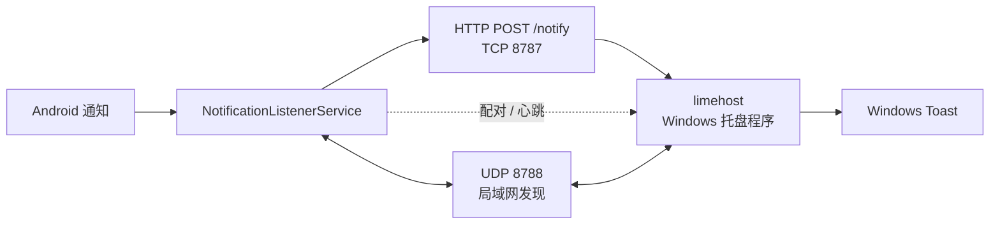

# LimeLink（小青柠）

<p align="center">
  
</p>

<p align="center">把 Android 通知同步到 Windows 桌面，以原生 Toast 弹出。</p>

LimeLink 是一个局域网优先的通知同步工具：Android 端通过 `NotificationListenerService` 读取通知，经 HTTP 推送到 Windows 端，由 Windows 端以系统 Toast 展示。无需账号、无需公网中转，手机与电脑处于同一局域网即可工作。

> 当前源码版本：**电脑端 1.2.2**，**Android 端 1.2.0（versionCode 5）**。两端独立发布，版本号不要求一致。

## 功能

- 手机通知实时同步到 Windows Toast，保留标题、正文与来源 App
- 同一来源的新通知立即替换旧 Toast，不排队等待
- 微信、短信、系统通知、其他 App 四类开关，可分别启用
- 6 位配对码换取长期 token，之后的推送携带 token
- 心跳检测、断线指数退避重连、UDP 广播自动重新发现电脑
- 两端设备名可修改，默认自动生成
- Android 常驻状态通知，可直接暂停 / 恢复同步
- Windows 托盘菜单：本机地址、配对码、设备改名、最近记录、重置配对、关于
- 电脑端单文件 exe，无安装器、无服务常驻

## 工作原理



| 组件 | 技术栈 | 位置 |
| --- | --- | --- |
| 电脑端 | Go 1.27、标准库 `net/http`、systray | `pc/` |
| 手机端 | Kotlin、AndroidX、OkHttp | `android/` |

## 环境要求

- Windows 10 / 11（电脑端）
- Android 8.0+（`minSdk 24`）
- 手机与电脑处于同一局域网，或连接电脑的移动热点

## 快速开始

### 1. 获取程序

在本仓库的 **Releases** 页面下载 `limehost.exe` 和 `app-release.apk`。源码仓库不包含编译产物。

### 2. 启动电脑端

双击 `limehost.exe`，程序会出现在系统托盘。首次启动时 Windows 防火墙可能询问是否允许访问网络，请允许**专用网络**。

如果手机无法连接或 UDP 自动发现失效，可在可信网络中以管理员身份运行 `fix-firewall.ps1`，为 TCP 8787 / UDP 8788 添加入站规则。该脚本也会对公共网络配置文件放行，使用前请阅读 [安全说明](SECURITY.md)。

### 3. 安装手机端

安装 `app-release.apk`，打开后按提示授予「通知读取权限」；Android 13+ 还会请求通知权限，用于显示常驻状态通知。

### 4. 配对

1. 在电脑托盘右键，查看「本机地址」和「配对码」。
2. 手机端填写电脑 IP、端口（默认 `8787`）和 6 位配对码，点击「连接并配对」。
3. 配对成功后，两端会先做一次心跳验证；通道真正可用后手机才会显示「已连接」。

如需让微信通知显示「发送者 + 内容」，请在微信中开启「通知显示消息详情」。关闭时 LimeLink 只同步系统实际提供的内容，不会编造。

## 从源码构建

### 电脑端（Go）

要求 Go 1.27+。

```powershell
cd pc
New-Item -ItemType Directory -Force bin | Out-Null
go build -trimpath -ldflags "-s -w -H windowsgui" -o bin\limehost.exe ./cmd/limehost
```

产物为 `pc/bin/limehost.exe`。`.syso` 资源文件已提交，`go build` 会自动嵌入图标与版本信息。若修改了版本号并需要重新生成资源：

```powershell
cd pc/cmd/limehost
go run github.com/tc-hib/go-winres@latest simply `
  --icon assets/lime.ico `
  --product-name "小青柠 LimeLink" `
  --product-version "1.2.2" `
  --file-version "1.2.2" `
  --file-description "LimeLink PC 接收端"
```

运行测试：

```powershell
cd pc
go test ./...
```

### Android 端

要求 JDK 17、Android SDK Platform 34。项目已包含 Gradle Wrapper 8.7（与 AGP 8.5.2 匹配）。

```powershell
cd android
.\gradlew.bat assembleDebug
```

Linux / macOS 使用 `./gradlew assembleDebug`。

> 如果 `gradlew` 下载 Gradle 时因企业代理或 TLS 证书校验失败，可将代理根证书导入 JDK 信任库，或直接使用本机已安装的 Gradle 8.7+ 执行相同任务。

首次构建前请确保 Gradle 能找到 Android SDK：设置 `ANDROID_HOME`，或在 `android/local.properties` 中写入本机 `sdk.dir`。`local.properties` 已被忽略，不会提交。

#### 构建 Release 包

签名信息从 `android/keystore.properties` 读取；该文件与 `.jks` 均被 `.gitignore` 忽略。

```powershell
cd android
Copy-Item keystore.properties.example keystore.properties
# 编辑 keystore.properties，并将你的 keystore 放到其中 storeFile 指定的位置
.\gradlew.bat assembleRelease
```

产物位于 `android/app/build/outputs/apk/release/`。没有 `keystore.properties` 时仍可执行 `assembleRelease`，但得到的是未签名包。

升级安装必须使用同一个 keystore；请自行备份 `.jks` 与密码，丢失后无法再发布可覆盖安装的更新。

## 配置与数据

- 电脑端配置：`%AppData%\LimeLink\config.json`，包含 `port`（默认 8787）和 `device_name`。
- 最近同步记录仅保存在内存中，电脑端进程重启后清空。
- Android 设置保存在应用私有的 `SharedPreferences`（`limelink`）中，包含电脑地址、端口、token 和设备名。
- 重置配对：电脑托盘「重置配对」会生成新配对码并清除旧 token。

## HTTP 接口

电脑端在 TCP 8787 上提供以下接口，供手机端和二次开发使用。

| 方法 | 路径 | 鉴权 | 说明 |
| --- | --- | --- | --- |
| GET | `/ping` | 无 | 在线探测，返回 `ok`、`paired`、`code`、`name` |
| POST | `/pair` | 配对码 | 请求体 `{"code":"123456","name":"手机名"}`，返回 token 与电脑端设备名 |
| POST | `/notify` | `X-LimeLink-Token` | 推送一条通知 |
| GET / POST | `/heartbeat` | `X-LimeLink-Token` | 心跳，返回通道是否可用 |
| GET | `/records` | `X-LimeLink-Token` | 返回最近同步记录 |
| POST | `/reset` | 无 | 重置配对码并踢掉已配对设备 |
| GET | `/debug/state` | 无 | 排查用运行状态 |

`/notify` 请求体示例：

```json
{
  "id": "unique-id",
  "title": "标题",
  "text": "正文",
  "app_name": "微信",
  "app_label": "wechat",
  "icon_type": "wechat",
  "pkg": "com.tencent.mm",
  "hidden": false,
  "ts": 1760000000000
}
```

Windows 上建议使用 `curl.exe`，避免 PowerShell 的 `curl` 别名：

```powershell
curl.exe -X POST http://127.0.0.1:8787/notify `
  -H "Content-Type: application/json" `
  -H "X-LimeLink-Token: <token>" `
  -d '{"title":"测试","text":"来自 LimeLink","app_name":"Test","app_label":"app","icon_type":"app"}'
```

> 上述未鉴权接口是当前版本的已知安全边界。仅应在可信局域网内使用，详见 [SECURITY.md](SECURITY.md)。

## 安全说明

LimeLink 面向可信局域网，不适合直接暴露到公网。当前版本存在以下边界：

- `GET /ping` 无需鉴权并返回当前配对码；`/reset` 与 `/debug/state` 也无需鉴权。
- CORS 允许任意来源，浏览器页面可发起跨域请求。
- 通信为明文 HTTP；Android 端 token 明文保存在 `SharedPreferences`，且应用允许系统备份。
- `fix-firewall.ps1` 会为 Domain / Private / Public 三个配置文件开放端口。
- 6 位配对码没有尝试频率限制，配对成功后才使用 32 位随机 token。

**不要**把 8787 / 8788 映射到公网，也不要在公共 Wi-Fi 或云主机上运行。完整说明与报告方式见 [SECURITY.md](SECURITY.md)。

## 已知限制

- **微信内容完整度**：取决于手机是否开启「通知显示消息详情」，关闭时只能拿到系统提供的内容。
- **Toast 降级**：Toast 被系统禁用或不可用时，降级为托盘气泡。
- **Toast 覆盖范围**：按来源覆盖，同一 App 内不同会话也会互相替换，这是“只保留最新一条”的取舍。
- **UDP 发现**：部分路由器或热点禁用子网广播，此时会回退到已保存 IP 重连，必要时需手动改 IP。
- **后台限制**：Android 厂商的省电策略可能杀死监听服务；需要允许后台运行并将应用加入电池优化白名单。Android 15 的 `dataSync` 前台服务还可能有约 6 小时的系统时长限制。
- **单设备**：电脑端同一时间只保存一个已配对手机。
- **记录不持久化**：电脑端重启后「最近同步记录」清空。
- **改名对话框**：电脑端设备改名依赖桌面会话，以服务方式运行时不支持。

## 项目结构

```
LimeLink/
├── android/                    Android 客户端
│   ├── app/src/main/java/      Kotlin 源码
│   ├── app/src/main/res/       布局与资源
│   ├── gradle/wrapper/         Gradle Wrapper
│   └── keystore.properties.example
├── pc/                         Windows 客户端（Go）
│   ├── cmd/limehost/           主程序、托盘、内嵌资源
│   ├── internal/server/        HTTP 服务、配对、心跳、记录
│   ├── internal/discovery/     UDP 发现服务
│   ├── internal/notifier/      Toast 与降级
│   ├── internal/toast/         内嵌 go-toast（含原始 LICENSE）
│   ├── internal/config/        配置
│   └── internal/netinfo/       本机地址探测
├── assets/                     图标源文件与生成脚本
├── fix-firewall.ps1            Windows 防火墙规则脚本
├── SECURITY.md                 安全边界与漏洞报告
├── THIRD_PARTY_NOTICES.md      第三方组件许可
└── CHANGELOG.md                版本记录
```

## 第三方组件

- `pc/internal/toast` 基于 `github.com/go-toast/toast`（MIT，Copyright (c) 2016 Jacob Marshall）修改并内嵌，原始许可见 `pc/internal/toast/LICENSE`。
- Windows 托盘使用 `github.com/getlantern/systray`（Apache-2.0）；设备改名对话框使用 `github.com/gen2brain/dlgs`（BSD-2-Clause）。
- Android 端使用 AndroidX、Material Components、OkHttp、Kotlin 与 kotlinx.coroutines（Apache-2.0）。

完整列表见 [THIRD_PARTY_NOTICES.md](THIRD_PARTY_NOTICES.md)。

## 许可证

本项目以 [MIT License](LICENSE) 发布。第三方组件遵循各自许可证。

## 更新记录

见 [CHANGELOG.md](CHANGELOG.md)。
