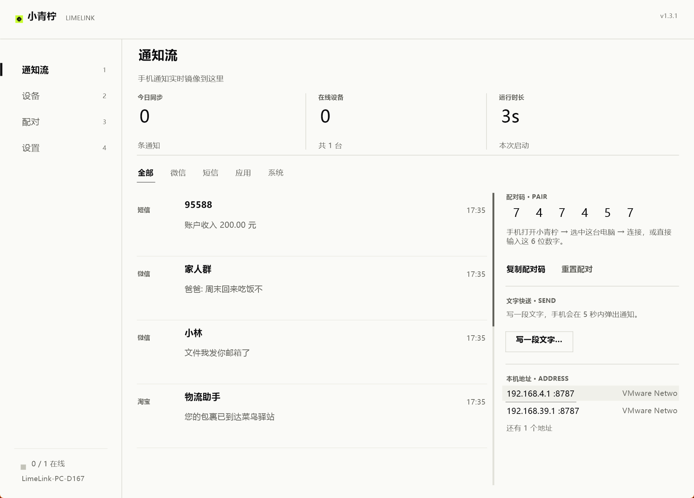
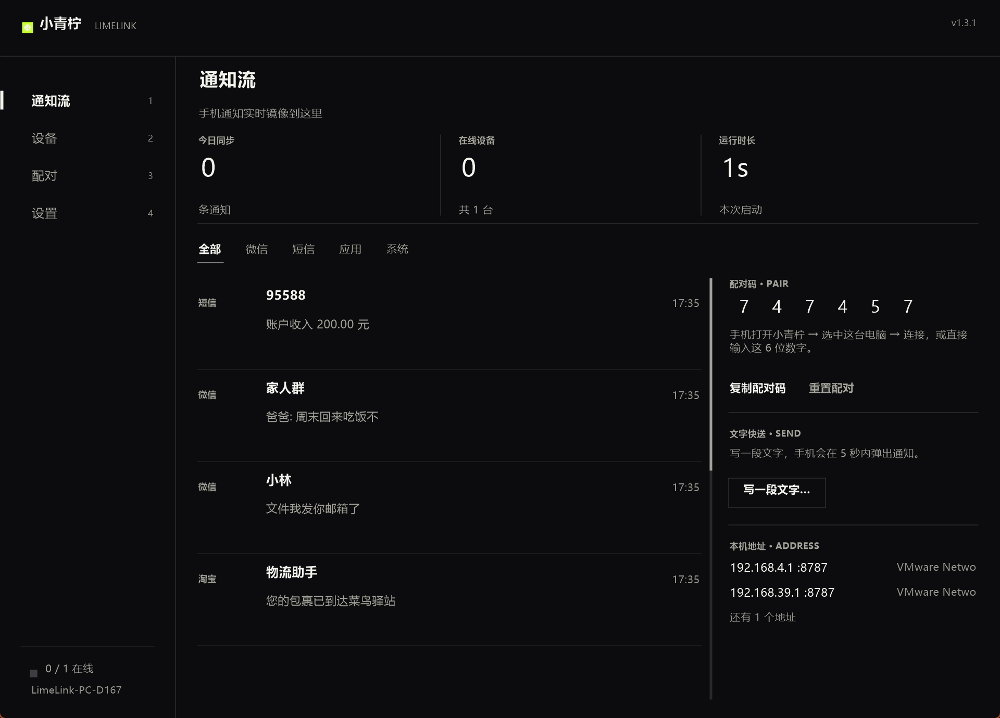
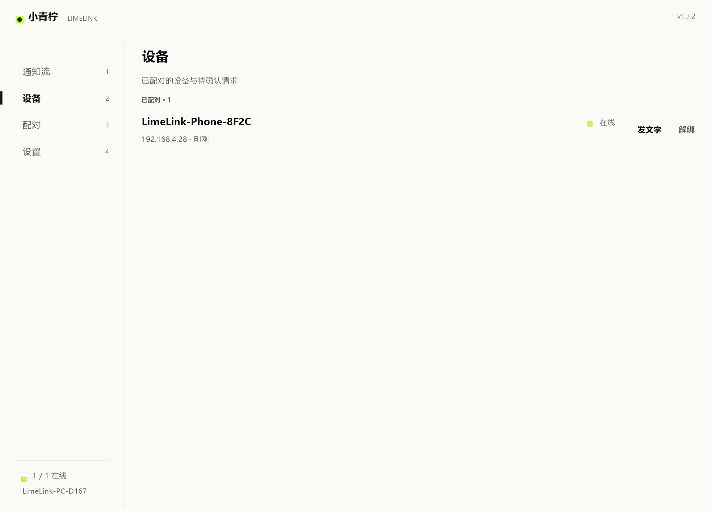
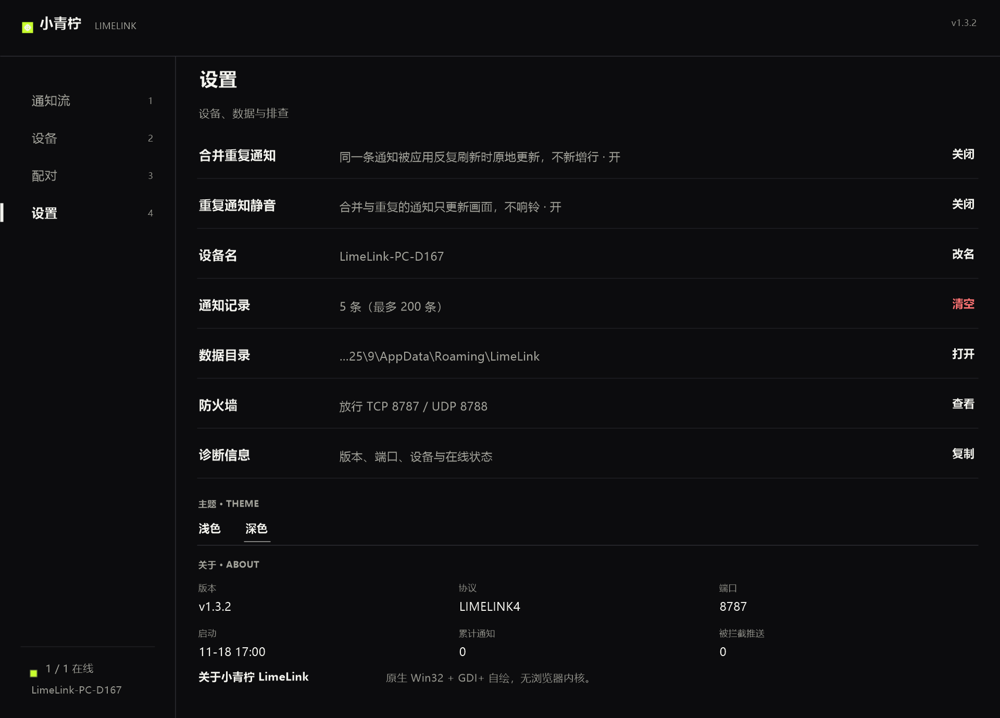

<p align="center">
  
</p>

<h1 align="center">LimeLink（小青柠）v1.3.2</h1>

<p align="center">
  把 Android 通知镜像到 Windows 桌面，局域网直连、原生 Toast 弹出。<br/>
  电脑端是<b>原生 Win32 自绘界面</b>（无浏览器、无 WebView2、无 CGO），手机端是 Kotlin。
</p>

<p align="center">
  <a href="https://github.com/ai123lp456/LimeLink/releases">下载</a> ·
  <a href="#快速开始">快速开始</a> ·
  <a href="#从源码构建">构建</a> ·
  <a href="SECURITY.md">安全模型</a> ·
  <a href="CHANGELOG.md">更新记录</a>
</p>

---

## 这是什么

LimeLink 是一个**局域网优先**的通知同步工具：

- Android 端用 `NotificationListenerService` 读取通知，通过 HTTP 推送到电脑；
- Windows 端用原生 Toast 弹出，同一来源的新通知会**覆盖**旧通知，不排队刷屏；
- 电脑端界面由 Go 直接调用 Win32 + GDI+ 绘制，**没有内嵌浏览器**，不依赖 Edge/Chrome/WebView2，
  产物仍是单个约 10 MB 的 exe；
- 连接参考 LocalSend：手机打开 App 就能看到「附近的电脑」，点一下 → 电脑点「允许」→ 完成。

不联网、不上传云端、不需要注册。手机和电脑连同一个 Wi-Fi / 热点即可。

## 界面

瑞士极简（Minimalism & Swiss Style）：纸白底、墨黑字、1px 细线、严格网格、单一强调色（青柠），
无圆角、无阴影、无渐变；信息层级只靠字号、字重和留白。

| 浅色 · 通知流 | 深色 · 通知流 |
| --- | --- |
|  |  |
| **浅色 · 设备** | **深色 · 设置** |
|  |  |

- **两种主题**：浅色（纸白 #FAFAF7 + 墨黑 #0E0E10）与深色（#0C0C0E + #F3F3EE），在「设置 → 主题」切换，选择会写进配置，下次启动保持。
- 线色比 1.3.0 更深（#C3C3B9 / 深色 #3D3D43），但仍是 1px，不加粗。
- 版式：顶栏 72、导航 224、页边 28、列表行 118、设置行 70。
- 字号：正文 20、行标题 22、页面标题 32、统计数字 44、配对码 54，最小不低于 16。
- 默认窗口 1280×920（逻辑像素），最小 1080×720。

手机端同一套排版：顶栏 56dp、列表行 60dp 以内、正文 12–15sp、分区之间只有 1px 细线，
不再用「大色块 + 小字」的卡片。

## 功能

**电脑端（Windows）**
- 原生窗口：通知流 / 设备 / 配对 / 设置四页，键盘 `1`–`4` 切页、`Tab` 遍历控件、`Enter` 触发、`Esc` 收进托盘
- 手机请求连接会推系统通知；窗口收在托盘时自动唤起并落到「设备」页，导航上带待确认数量徽标
- 通知行右键：复制正文 / 复制标题 / 删除这条；标题被截断时悬停可看全文
- 浅色 / 深色两套主题，设置页一键切换并记住
- 滚在列表下面时来了新通知，顶部给「↑ N 条新通知」提示；提示条最多堆 3 条
- 通知流：按来源分类筛选、今日/在线/运行时长三栏统计、最近 200 条本地记录；滚动条可拖拽，支持方向键 / PageUp·PageDown / Home·End
- 设备页：在线状态、最近心跳、一键发文字到手机、解绑、待确认请求（允许 / 拒绝）
- 配对页：六位配对码大字排版、本机各网卡地址点一下复制、重置配对
- 设置页：改设备名、清空记录、打开数据目录、防火墙命令、诊断信息复制
- **重复通知处理**（v1.3.2）：同一条通知被应用反复刷新时，记录原地更新为一行并标「实时」，
  不再每 5 秒弹一次、响一次；「合并重复通知」「重复通知静音」两个开关默认开，可在设置页关掉
- 托盘常驻：打开界面 / 本机地址 / 配对码 / 改名 / 最近记录 / 启动时打开界面 / 重置 / 退出
- 单实例：重复启动只会把已有窗口提到前台

**手机端（Android）**
- 「附近的电脑」自动发现，免码连接（电脑端允许即可）
- 通知实时推送；四个分类开关（微信 / 短信 / 应用 / 系统）
- **分级判重**（v1.3.2）：计时 / 进度 / 播放中这类会自我刷新的通知只推首次，之后静默更新；
  通话、闹钟、导航、录屏投屏永远推送并响铃；验证码、金额这类纯数字消息不做任何归一化
- 「合并计时/进度类通知」开关（默认开），关掉即回到 1.3.1 的「收到就推」
- 常驻状态通知：未授权 / 已暂停 / 等待连接 / 已连接，可直接暂停与恢复
- 接收电脑端发来的文字，弹出「来自电脑」通知
- 设备名可修改；配对码与手动 IP 作为备用通道

## 环境要求

- Windows 10 / 11（电脑端，单 exe 免安装）
- Android 7.0+（`minSdk 24`）
- 手机与电脑处于同一局域网，或手机连接电脑的移动热点

## 下载安装

到 [Releases](https://github.com/ai123lp456/LimeLink/releases) 下载：

- `LimeLink-PC-1.3.2.exe` — 免安装，双击运行
- `LimeLink-Android-1.3.2.apk` — 正式签名包，可直接覆盖升级

> 国内镜像：<https://gitee.com/ai123lp456/lime-link>（源码同步；Release 附件优先用 GitHub）

## 快速开始

1. **电脑**：运行 exe。托盘出现青柠图标，同时弹出界面窗口。
2. **手机**：安装 APK，打开后自动扫描局域网，「附近的电脑」出现这台电脑。
3. 点「连接」→ 电脑界面弹出「允许连接」→ 点「允许」。手机显示「已连接电脑」。
   - 电脑没开界面时，用手机下方「配对码 / 手动地址」填 6 位码。
4. 首次连接会引导开启「小青柠」的**通知读取权限**（Android 13+ 还会请求通知权限，用于状态条）。
5. 手机来通知，电脑弹 Toast。之后电脑重启、手机重连都会自动恢复。

### 防火墙

手机能看到电脑但连不上，通常是 Windows 拦了端口：

- 放行 **TCP 8787**（通知 / 配对 / 心跳）与 **UDP 8788**（局域网发现）；
- 以管理员身份运行仓库里的 `fix-firewall.ps1`，或手动：

```powershell
netsh advfirewall firewall add rule name="LimeLink TCP 8787" dir=in action=allow protocol=TCP localport=8787
netsh advfirewall firewall add rule name="LimeLink UDP 8788" dir=in action=allow protocol=UDP localport=8788
```

脚本按**端口**放行（不绑定程序路径），以后换目录、升级都不用重跑；代价是这两个端口对所有程序开放。

## 连接是怎么做的

```
手机                                     电脑
 │  UDP 8788 broadcast/multicast probe     │
 │ ──────────────────────────────────────► │
 │ ◄──── announce {name, port, ver} ───────│  「附近的电脑」出现
 │                                         │
 │  POST /pair/request  {device_id, name}  │
 │ ──────────────────────────────────────► │  界面弹出「允许连接」
 │ ◄──── {status:"pending", req_id} ───────│
 │  GET /pair/status?id=... （每 1.2s）     │
 │ ◄──── {status:"approved", token} ───────│  点「允许」
 │  GET /heartbeat  (X-LimeLink-Token)     │
 │ ──────────────────────────────────────► │  心跳成功才算真正 CONNECTED
```

- 已配对过的 `device_id` 再次请求会直接放行并回同一个 token —— 这是「电脑重启后手机自动连回」的实现方式。
- 电脑端界面与 `/api/*` 只允许 `127.0.0.1` 访问；手机端用 32 位随机 token 鉴权，每台设备独立。
- 发现报文同时兼容旧版（v1.2.x）的裸字符串探测。

## 重复通知是怎么处理的（v1.3.2）

Android 的 `onNotificationPosted()` 对「已有通知被刷新」同样回调，时间侦探、B 站、酷狗这类应用
会周期性刷新同一条常驻通知（实测约 5 秒一次），1.3.1 把它当成新通知逐条推送、逐条响铃。
1.3.2 在手机端和电脑端各加一层，规则如下：

| 层 | 规则 |
|---|---|
| 手机端 · 白名单 | `CATEGORY_CALL` / `ALARM` / `NAVIGATION` / `SERVICE`（通话、闹钟、导航、录屏投屏）永远推、永远响 |
| 手机端 · 实时状态类 | 应用声明「只提醒一次」，或常驻通知带进度条 / 秒表 / `CATEGORY_PROGRESS` → 首次推、之后静默刷新（消息类 `MESSAGE`/`EMAIL`/`SOCIAL` 永不按实时处理） |
| 手机端 · 内容指纹 | 普通通知比原文；实时状态类先把 `10:42`、`5 分钟`、`45%` 归一化再比 |
| 手机端 · 频率闸 | 同一 `(包名, key)` 最快 20 秒一条；微信 / 短信豁免 |
| 电脑端 · 合并 | `live` 且带 `key` 的通知原地更新最近一条同 key 的实时记录，不新增行 |
| 电脑端 · 兜底 | 同 `(包名, 标题, 归一化正文)` 10 秒内重复到达 → 不落记录，只静默更新弹窗 |

几处实现取舍，PRD 没写死、这里说明理由：

- **普通通知的内容去重窗口是 10 秒，不是 60 秒**：同一个人连着发两条一模一样的话是正常聊天，
  窗口太长会漏消息；实时状态类仍然是 60 秒（它本来就该慢一点刷新）。
- **频率闸对微信 / 短信豁免**：群聊里 20 秒内来十几条不同内容是常态，按 key 限流会误杀。
- **合并最多往回找 30 分钟**：否则昨天的倒计时会把今天的新计时记录「吃掉」，
  记录区看起来一直停在昨天。超过 30 分钟的实时通知按新记录处理。
- **归一化只对实时状态类生效**：验证码 `1234 → 5678`、金额、条数永远走原文比对，不会被误判成同一条。
- **记录时间显示最后刷新时间**：实时记录时间栏显示「实时 hh:mm」，让人知道这条在变。
- 两个开关都关掉后，两端都完全回到 1.3.1 的行为。

## 从源码构建

### 电脑端（Windows + Go 1.21+）

```powershell
cd pc
go vet ./...
go test ./...
go build -ldflags "-s -w -H windowsgui" -o bin/limehost.exe ./cmd/limehost
```

界面代码在 `pc/internal/winui/`：`win32.go` 是系统调用，`draw.go` 是 GDI+ 绘制与双缓冲，
`paint.go` 是四个页面的排版，`app.go` 是消息循环与交互。没有任何第三方 UI 库。

图标与版本信息由 `pc/cmd/limehost/rsrc_windows_*.syso` 提供（已随仓库提交），`go build` 自动嵌入；
改版本号时重新生成：

```powershell
cd pc/cmd/limehost
go run github.com/tc-hib/go-winres@v0.3.3 simply --icon assets/lime.ico `
  --product-name "小青柠 LimeLink" --product-version "1.3.2" --file-version "1.3.2" `
  --file-description "LimeLink 电脑端接收器"
```

### Android 端（JDK 17 + Android SDK 34）

仓库带 Gradle Wrapper：

```powershell
cd android
./gradlew assembleDebug      # 调试包
./gradlew assembleRelease    # 正式包（需要本地签名配置）
```

没有配置 `ANDROID_HOME` 时，在 `android/local.properties` 写一行 `sdk.dir=<你的 SDK 路径>`（该文件不入库）。

### 发布签名

仓库**不包含**任何 keystore 或密码。要出正式签名包，请自备 keystore 并在 `android/keystore.properties` 填写
（参考同目录的 `keystore.properties.example`）：

```properties
storeFile=your-release.jks
storePassword=******
keyAlias=******
keyPassword=******
```

`*.jks`、`keystore.properties`、`local.properties` 均在 `.gitignore` 中。已安装用户只能被同一 keystore 签名的包覆盖升级。

## 目录结构

```
LimeLink/
├── pc/                         电脑端（Go）
│   ├── cmd/limehost/           入口、托盘、Win32 资源
│   └── internal/
│       ├── winui/              原生界面：win32 调用 / GDI+ 绘制 / 四页排版 / 交互
│       ├── server/             HTTP 服务：配对 / 心跳 / 通知 / 设备 / 记录
│       ├── discovery/          UDP 发现（announce / probe / 组播）
│       ├── notifier/           Windows Toast + 降级
│       ├── toast/              内嵌 go-toast（MIT，新增 Tag/Group）
│       ├── config/             配置
│       └── netinfo/            本机 IP
├── android/                    手机端（Kotlin）
│   └── app/src/main/java/com/limelink/app/
├── assets/                     图标、界面截图、图标生成脚本
├── docs/TESTING.md             验证清单（自动 / 人工 / 真机）
├── licenses/                   第三方许可证全文
├── fix-firewall.ps1            防火墙放行脚本
├── CHANGELOG.md                更新记录
├── SECURITY.md                 安全模型与已知边界
└── THIRD_PARTY_NOTICES.md      第三方组件声明
```

## 已知限制

- **仅用于可信局域网**：HTTP 明文传输，不抗同网段窃听，不要映射到公网。
- **界面是自绘的**：所有控件由代码绘制，没有系统原生控件那种「接上手感」，也没有滚动惯性；
  文本输入走系统对话框（改名 / 发文字），不支持界面内富文本编辑。
- **首次启动可能慢**：Windows 首次为新 exe 放行端口可能要十几秒到几十秒（界面会等你，不会白屏）。
- **组播/广播被拦**：部分路由器会拦广播或组播，实现采用三路齐发，极端环境仍需手动填 IP。
- **微信内容完整度**：取决于手机是否开「通知显示消息详情」，本工具如实同步、不做猜测。
- **后台保活**：多数国产系统需手动允许后台运行 + 电池白名单，否则监听服务会被杀。
- **Android 15 的 dataSync 前台服务有时长限制**：超时后可能被暂停，重开 App 恢复。
- **安装包未做商业代码签名**：Windows 可能提示 SmartScreen，请核对 Release 中的 SHA256。

## 常见问题

**手机找不到电脑？**
确认电脑端已启动（托盘有小青柠图标）、两端在同一网络、已放行 UDP 8788；仍不行就用「手动地址」填 IP。

**手机显示已连接但电脑不弹窗？**
多为防火墙拦了 TCP 8787；在电脑端「设置 → 防火墙 → 查看」复制命令，用管理员终端跑一次。

**电脑重启后要重新配对吗？**
不需要。设备和 token 已持久化；只有手机重装 App（设备 id 变了）才需要重新允许一次。

**关掉窗口程序就没了吗？**
没有。窗口只是收进托盘，右键托盘图标可以再打开，或在「设置」里勾选「启动时打开界面」。

## 安全与隐私

- 不联网、不中转、不上传云端；通知内容只在手机与电脑之间传输。
- 配对后使用长期 token 鉴权；电脑端界面与 `/api/*` 仅本机可访问。
- 详细的安全边界（包括已知弱点）见 [SECURITY.md](SECURITY.md)。

## 参与贡献

- 提交 Issue 前请先看 [SECURITY.md](SECURITY.md) 的已知边界。
- 代码风格：Go 走 `go vet` + `go test`；Android 保持 Kotlin 官方风格。
- 改界面时请保持「瑞士网格」约定：1px 细线、无阴影、无圆角、字号层级不超过 6 档。

## License

[MIT](LICENSE)。第三方组件许可见 [THIRD_PARTY_NOTICES.md](THIRD_PARTY_NOTICES.md)。

## 致谢

- [go-toast](https://github.com/go-toast/toast)（内嵌修改，MIT）
- [systray](https://github.com/getlantern/systray)、[dlgs](https://github.com/gen2brain/dlgs)
- AndroidX、Material Components、OkHttp、Kotlin / kotlinx.coroutines
